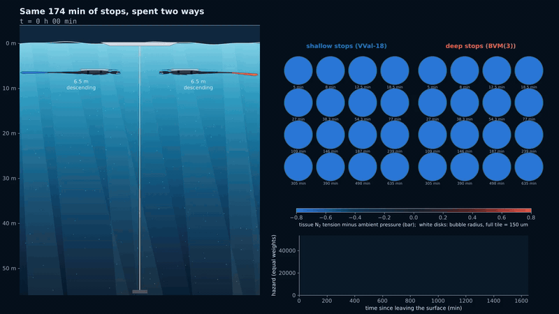
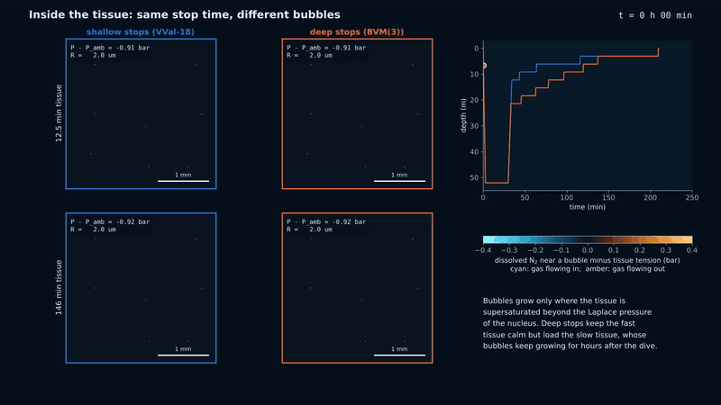
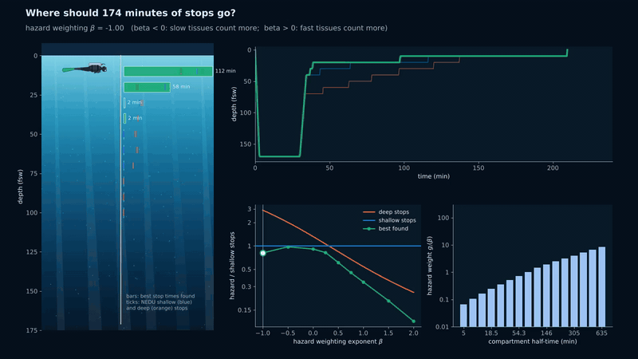

# Deep Stop Paradox

[](https://www.python.org/)
[](LICENSE)
[](https://numpy.org/)
[](https://scipy.org/)
[](https://matplotlib.org/)


Supplementary code for the manuscript

> **When deep stops lose: nucleation thresholds and shadow prices in a two-phase model of scuba decompression**
>
> Sandy H. S. Herho, Alfita P. Handayani, Faruq Khadami, Iwan P. Anwar, Karina A. Sujatmiko, Rusmawan Suwarman, and Dasapta E. Irawan

Bubble models of decompression predicted that spending part of the stop time deeper ("deep stops") would make a dive safer. A large U.S. Navy trial found the opposite: with the same 174 min of stops after a 170 fsw (52 m) air dive for 30 min, the deep-stops schedule produced 10 cases of decompression sickness in 198 dives, against 3 in 192 for the conventional shallow-stops schedule (Doolette, Gerth and Gault, NEDU TR 11-06, 2011). The authors attributed the result, in words, to continued gas uptake by slow tissues during the deep stops.

This repository turns that sentence into a calculation. A two-phase model (dissolved nitrogen in 16 perfusion compartments, plus a population of gas nuclei in each that grow and shrink by diffusion) is integrated together with its exact sensitivities. The sensitivities give the **shadow price** of tissue gas and of bubble size in every compartment at every moment of the dive, and from them the exact change in risk caused by moving one minute of stop time from one depth to another. The question "do deep stops help?" becomes a sign: the sum, over compartments, of what the move saves in fast tissues and what it costs in slow ones.

The answer turns out to hinge on one physical quantity, the **growth threshold**: the supersaturation a gas nucleus needs before it grows (`2 sigma / r0 - p_m`). If slow tissues can form bubbles during an air decompression (threshold below about 0.3 bar in this model), deep stops lose, as in the trial. If they cannot, deep stops win by a wide margin. Read this way, the NEDU result is evidence about bubble nucleation in slow tissues.

The model is idealized. It uses no observational data; the two NEDU schedules are used only as published inputs, and the observed incidences only as a check. No number in it is a validated risk for a person or a dive.

[](outputs/animations/anim01_shotline.gif)

## The model in brief

Each compartment `i` (ZH-L16C half-times, 5 to 635 min) has a nitrogen tension `P_i` and nuclei of number density `N` and radius `R_i`, stabilized at `r0` and unable to dissolve below it. The nitrogen pressure inside a bubble is the ambient pressure, plus the Laplace pressure, minus the metabolic gases (O2, CO2, H2O) that every tissue bubble also contains:

```
P_b = P_amb - p_m + 2 sigma / R
```

Quasi-steady diffusion of nitrogen to a sphere and the ideal-gas content `P_b R^3` give the radius equation, and the gas the bubbles take is removed from the tissue, so nitrogen is conserved exactly apart from perfusion:

```
dR/dt = [ D lambda (P - P_b) - (R^2/3) dP_amb/dt ] / [ R (P_amb - p_m) + (4/3) sigma ]
dP/dt = k (P_art - P) - (4 pi N / 3 lambda) d(P_b R^3)/dt
dQ/dt = N (4 pi / 3) (R^3 - r0^3) / v_ref                (bubble volume, integrated)
```

The hazard is `H = sum_i g_i Q_i`, accumulated until 24 h after surfacing, with the probability of DCS `1 - exp(-H)`. Which tissues matter for DCS is not known, so the weights are a one-parameter family,

```
g_i(beta) = (tau_i / tau_gm)^(-beta),
```

where `beta = 0` gives every unit of bubble volume the same weight, `beta > 0` weights fast tissues more (the implicit choice of bubble models that favor deep stops), and `beta < 0` weights slow tissues more. Every result is reported as a function of `beta`.

**Exact gradients.** For each depth segment the solver integrates the state together with its transition matrix. Composing these backwards gives the costates `lambda_P(t)`, `lambda_R(t)` of every compartment, the price in final hazard of one more bar of tension or one more micrometre of bubble radius. Lengthening stop `j` by `d tau` then changes the hazard of compartment `i` by

```
dQ_i/d tau_j = lambda_P f_P + lambda_R f_R + f_Q        (evaluated at the end of stop j)
```

so a single run returns the derivative of every compartment's hazard with respect to every stop time. These derivatives agree with finite differences to 3e-8.

**A unique critical weighting.** Moving time from a shallow to a deeper stop changes the compartment hazards by `E_i`. The weighted change `sum_i E_i exp(-beta x_i)`, with `x_i = ln(tau_i / tau_gm)`, is an exponential sum, so by Laguerre's extension of Descartes' rule of signs it has at most as many zeros in `beta` as `E_i` has sign changes along the half-times. Whenever slow tissues form bubbles, `E_i` changes sign exactly once in the cases computed here (deep time helps fast tissues and hurts slow ones), so there is exactly one critical exponent `beta_c`: the move lowers the total hazard if and only if `beta > beta_c`. When only fast tissues form bubbles there is no sign change and deep time helps at every weighting.

## Main results

All numbers below come from `outputs/reports/results.txt`.

| Result | Where |
|---|---|
| The costate derivatives of the hazard agree with central finite differences to 3e-8, and the nitrogen budget of every compartment closes to 8e-10 | `compute_verification.py`, Fig. 2 |
| With equal weights, the NEDU deep-stops schedule carries 1.32 times the hazard of the shallow-stops schedule | `compute_nedu.py`, Figs. 1, 3 |
| Deep stops lower the bubble hazard in the six fastest compartments (5 to 38 min) and raise it in the next seven (54 to 305 min), with exactly one change of sign along the half-times | Fig. 3 |
| The two schedules tie at a single critical weighting, beta_c = 0.31: deep stops win only if fast tissues count for more than this | Fig. 3 |
| The observed incidence ratio, 3.2 (95% interval 0.90 to 11.6), is reproduced only for beta at or below 0.42, with the point estimate at beta = -1.2: the trial is consistent with slow tissues mattering at least as much as fast ones, and not with the fast-tissue weighting that makes deep stops look best | Fig. 3 |
| In the 146 min compartment, bubbles persist about 22 h after surfacing on the deep-stops schedule, against 13 h on the shallow-stops schedule | Figs. 1, anim. 2 |
| The first minute moved from 10 fsw to any deeper stop (20 to 70 fsw) lowers the hazard even with equal weights (beta_c from -0.94 to -0.34): per minute moved to 70 fsw, the fast compartments save 482 units and the slow ones pay 242 | `fig04_shadow`, Fig. 4 |
| For every weighting from beta = -1 to 2, the search finds a distribution of the same 174 min with lower hazard than both NEDU schedules: 3% to 89% below the shallow stops and 22% to 72% below the deep stops | `compute_optimal.py`, Fig. 5 |
| With equal weights, the best distribution found puts most of the time in the middle of the ascent (119 of 174 min at 30 and 20 fsw), 28 min at 40 to 60 fsw and 27 min at 10 fsw; its hazard is 9% below the shallow stops and 31% below the NEDU deep stops | Fig. 5 |
| As fast tissues are weighted more, the best distributions move deeper gradually (deep-stop skew from 21 to 152 bar min over beta = -1 to 2). Along the straight line between the two NEDU schedules, however, the best point jumps (from 10% to 72% of the way at beta = 0.23), because the hazard along that line has two separate minima | Fig. 5, anim. 3 |
| The optimization landscape is rugged: restarting from the two NEDU schedules and a uniform distribution gives local optima whose hazards differ by 1% to 31%, so the stop times reported are the best of three starts, not proven global optima | `results.txt`, Fig. 5 |
| Over 42 air dives (24 to 60 m, 10 to 50 min) referenced to GF 90/85, moving time from the 3 m stop to a half-depth stop lowers the equal-weight hazard in 20 dives (long bottom times), and moving it to a Pyle stop in only 4 | `compute_phase.py`, Fig. 6 |
| For short dives (10 min) the half-depth stop pays only if beta exceeds 0.74 to 0.87; in every move computed the compartment changes switch sign at most once, so each critical weighting is unique | Fig. 6 |
| On the NEDU dive with GF-high 85, the equal-weight hazard is lowest near GF-low 60; GF-low 10 adds 18 min of stops yet lowers the hazard by only 5%, and with beta = -0.5 it raises it by 9% | `compute_gf.py`, Fig. 7 |
| **The growth threshold decides the sign.** Scanning the threshold from 0 to 0.55 bar, the equal-weight hazard ratio (deep/shallow) stays between 1.18 and 1.35 up to 0.25 bar, crosses 1 for the last time near 0.31 bar, falls to 0.36 at 0.40 bar, and to about 0.03 once no compartment of 54 min or slower forms bubbles. Varying the nucleus radius or the surface tension to reach the same threshold gives the same ratio within 2.2% | `compute_threshold.py`, Fig. 9 |
| Below 0.25 bar the critical weighting stays between beta_c = 0.21 and 0.31, below the bound of 0.42 set by the trial; above 0.32 bar it turns negative, so deep stops would win even with slow tissues weighted more | Fig. 9 |
| Across 128 Latin hypercube samples of all six bubble parameters (nucleus radius 1 to 4 um), deep stops are worse at equal weights in 78 of the 90 samples with a threshold at or below 0.25 bar (median ratio 1.22), in 13 of 18 between 0.25 and 0.35 bar, and in 1 of 20 above 0.35 bar (median ratio 0.15). Of the six parameters taken one at a time, the nucleus density has the strongest rank correlation with beta_c (-0.54) | `compute_sensitivity.py`, Figs. 8, 9 |

## What this may mean for divers

These are results of an idealized model, not tested procedures. They are offered as hypotheses for decompression researchers, instructors and technical divers to examine, not as replacements for any agency's tables or a dive computer's algorithm.

- **Middle stops, not deep ones.** In the model the first minutes taken from the last stop and spent deeper are cheap and even helpful, because they keep fast tissues from bubbling at the first big pressure drop. With equal weights the best distributions spend most of the time at 20 to 30 fsw (6 to 9 m) and little at 60 to 70 fsw. The NEDU deep schedule spent far more time deep than any of them.
- **Deep stops move bubbles, they do not remove them.** The deep-stops schedule had smaller bubbles during the ascent and larger, longer-lasting bubbles in slow tissues hours after the dive. If this holds in divers, symptoms after such profiles may appear late, and post-dive exertion and flying deserve the same care as after any long decompression.
- **Very low GF-low buys little.** GF-low below about 40% mostly adds minutes at depth. In the model those minutes did little or harm, depending on how much the slow tissues count. Moderate GF-low settings did as well or better.
- **On short no-decompression dives, a half-depth stop taken out of the safety stop did not lower the model hazard** unless fast tissues were assumed to dominate. Adding a deep stop as extra time is a different question and was not tested.
- **The answer depends on two unknowns: which tissues cause DCS, and how easily slow tissues form bubbles.** The model turns them into two numbers, beta and the growth threshold. The NEDU trial points to the region where slow tissues do bubble and count at least as much as fast ones. Experiments that detect bubbles in slow tissues after deep and shallow profiles would test this directly.

## Repository layout

```
deep_stop_paradox/
├── deep_stop_paradox/          # the library
│   ├── constants.py            # units, ZH-L16C table, reference bubble parameters
│   ├── profiles.py             # dive schedules, NEDU test schedules, deep-stop skew
│   ├── bubble.py               # two-phase model, solver with exact sensitivities
│   ├── buhlmann.py             # ZH-L16C gradient-factor planner (reference schedules)
│   ├── control.py              # exchange values, critical weighting, optimal redistribution
│   ├── diver_art.py            # diver drawing for the animations
│   ├── anim_style.py           # animation scenery and encoding
│   ├── plotting.py             # figure style
│   └── io.py                   # output paths, cache, CSV, reports
├── scripts/
│   ├── compute_*.py            # simulations (results cached as .npz)
│   ├── fig00_schematic.py ... fig09_threshold.py
│   ├── anim01_shotline.py, anim02_microscope.py, anim03_redistribution.py
│   ├── make_reports.py         # every number quoted from the simulations
│   └── run_all.py              # the whole pipeline
└── outputs/
    ├── figures/                # PDF and 600 dpi PNG
    ├── animations/             # MP4 and GIF
    ├── data/                   # CSV behind the figures
    └── reports/                # plain-text reports
```

## Installation

Python 3.9 or later.

```bash
git clone https://github.com/sandyherho/deep_stop_paradox.git
cd deep_stop_paradox
pip install -e .
```

The library depends only on NumPy, SciPy, Matplotlib and Pillow. The animations also need FFmpeg on the system path.

## Reproducing the results

```bash
python scripts/run_all.py            # simulations, figures, reports, animations
python scripts/run_all.py --no-anim  # skip the animations
```

The full pipeline takes about two to three hours on a two-core laptop, most of it in the multi-start optimal redistributions. Each script can also be run on its own; the figure and report scripts read the cached results in `outputs/cache/`. Random seeds (Latin hypercube, animation particles) are fixed.

A minimal example:

```python
import numpy as np
from deep_stop_paradox.bubble import TwoPhaseModel, hazard
from deep_stop_paradox.control import critical_beta, exchange
from deep_stop_paradox.profiles import nedu_schedule

model = TwoPhaseModel()
shallow = model.run(nedu_schedule("shallow"))       # with exact gradients
deep = model.run(nedu_schedule("deep"), sensitivities=False)
print(hazard(deep, 0.0) / hazard(shallow, 0.0))     # equal weights
print(critical_beta(deep.Q - shallow.Q))            # weighting that ties them
e = exchange(shallow, 6, 0)                          # one minute from 10 to 70 fsw
print(critical_beta(e))
```

## Figures

| | |
|---|---|
| `fig00_schematic` | Geometry of a compartment and a bubble, the diffusion field around a growing and a dissolving bubble, the segment discretization with forward states and backward costates, and the chain of numerical steps |
| `fig01_model` | The NEDU schedules; supersaturation, bubble radius and hazard in a fast and a slow compartment |
| `fig02_verification` | Costate gradients against finite differences, tolerance convergence, nitrogen budget, floor width |
| `fig03_nedu` | Compartment hazards, their single sign change, hazard ratio against weighting, observed ratio |
| `fig04_shadow` | Shadow prices of tension and radius along the shallow schedule; marginal value of a deeper minute |
| `fig05_optimal` | Hazard along the path between the NEDU schedules; best distribution of 174 min found from three starts, its hazard (with the spread between starts) and deep-stop skew |
| `fig06_phase` | Critical weighting for a half-depth stop and a Pyle stop over 42 air dives |
| `fig07_gf` | Gradient-factor low evaluated in the two-phase model; lowering GF-low both deepens the first stop and lengthens the total stop time, so the two effects are not separated here |
| `fig08_sensitivity` | Robustness to the six uncertain bubble parameters |
| `fig09_threshold` | Hazard ratio, critical weighting and slow-tissue bubbling against the growth threshold |

## Animations

**Inside the tissue.** A 3 mm slice of a fast (12.5 min) and a slow (146 min) tissue under each schedule. Bubbles are drawn at their true radius; the halos are the model's diffusion field, cyan where gas flows into a bubble and amber where it leaves.

[](outputs/animations/anim02_microscope.gif)

**Where should 174 minutes go?** The best distribution of the NEDU stop time found by the multi-start search, as the weighting sweeps from slow-tissue to fast-tissue dominated.

[](outputs/animations/anim03_redistribution.gif)

Divers are drawn larger than their real size (about 2.5 times in the first animation, more in the third), and exhaled bubbles rise faster than real ones (their Boyle's-law expansion is computed). Light shafts, particles and the boat are decorative; depths, tensions, bubble radii and hazards come from the model.

## Limitations

- The hazard is a modeling assumption: bubble volume integrated over time, with weights across tissues set by one exponent. The conclusions are stated as functions of that exponent rather than for one value, but the true dependence of DCS on bubbles in different tissues is not known.
- Compartments are perfusion-limited and independent, as in Buhlmann models. Diffusion between tissues, venous bubbles carried to the lungs, and arterialized bubbles are not modeled.
- All nuclei in a compartment have one radius and one number density, so each compartment has one sharp growth threshold. The conclusions change sign with that threshold (near 0.3 bar), and its value in human tissue is not known. A distribution of nucleus sizes would smooth the threshold; nuclei are neither created nor destroyed by the dive.
- The metabolic gas pressure in bubbles is constant (no dependence on inspired oxygen), so the oxygen window does not widen at depth or on oxygen-rich gases. Only air is studied.
- The bubble parameters are uncertain; the Latin hypercube varies each over about a factor of two. The reference nucleus radius (2 um) was chosen after a first run with 1 um nuclei produced no slow-tissue bubbles; with 1 um nuclei (threshold 0.42 bar) the model predicts that deep stops lower the hazard four-fold, opposite to the trial. This is why the threshold is reported as a controlling parameter rather than fixed.
- The trial divers exercised at depth and were cold during decompression; neither is modeled.
- The NEDU observations are used as a check, not to fit anything; the trial was stopped early and its confidence interval on the incidence ratio is wide (0.90 to 11.6).
- The hazard is piecewise smooth in the stop times (bubbles switch on at the threshold), so the optimization finds local optima. It is run from three starts and the best is kept; the spread between starts is reported, and the stop times of the best schedule should be read as one of several nearly equivalent distributions. They are not recommendations.

## Citation

If you use this code, please cite the manuscript and this repository (see `CITATION.cff`).

## Acknowledgments

This work was supported by the Faculty of Earth Sciences and Technology (FITB), Bandung Institute of Technology (ITB), through the PPMI Research Program 2026 (Project ID FITB.PPMI-1-19-2026), and by the ITB 3P Research Program (Talenta Unggul Scheme), Directorate of Research and Innovation, ITB (Project ID DRI.PN-6-64-2026). We thank Andini Alifah (SSI PRO 124122, Mazu Divers), Jemi Godjali (INA.F00.B3.0091, POSSI Board of Instructors), Mat Ningrum (INA.F00.B1.0375, Instrument Dive Adventure), Saep Saepudin (INA.F00.B1.0396, Indonesian Navy), and Subagiyo (INA.F00.B1.0412, Indonesian Navy) for their guidance, support, and expertise in scuba diving training.

## License

MIT License. Copyright (c) 2026 Applied Geology Research Group, Bandung Institute of Technology.
